<!--
  PYA (Protect Your Ass): free, open-source security audit plugin for Claude Code by Agrici Daniel.
  Code security review, vulnerability scanner, OWASP Top 10:2025, CWE Top 25, secret scanning,
  supply chain and malicious package detection, MITRE ATT&CK threat intel, AI-generated code,
  AI agent, MCP and prompt injection security. Nine read-only agents plus a verifier. MIT licensed.
-->


<h1 align="center">PYA: Protect Your Ass</h1>

<p align="center">
  <b>Free, open-source security audits inside <a href="https://claude.com/product/claude-code">Claude Code</a>.</b><br />
  Find what would hurt you before an attacker does.
</p>

<p align="center">
  <a href="#install">Install</a> ·
  <a href="#see-it-in-action">Demo</a> ·
  <a href="#meet-the-team">Team</a> ·
  <a href="#how-an-audit-works">How it works</a> ·
  <a href="#commands">Commands</a> ·
  <a href="#faq">FAQ</a>
</p>

<p align="center">
  <a href="https://github.com/AgriciDaniel/pya/actions/workflows/ci.yml"></a>
  <a href="https://claude.com/product/claude-code"></a>
  <a href="LICENSE"></a>
  <a href="CHANGELOG.md"></a>
  <a href="tests/"></a>
  <a href="https://github.com/AgriciDaniel/pya"></a>
  <a href="https://www.skool.com/ai-marketing-hub-pro"></a>
</p>

**PYA is a free security audit plugin for Claude Code.** Type `/pya` in any project and nine
specialist agents review your code at the same time. A verifier double-checks every serious
finding, and you get a 0 to 100 score with a fix list in the right order.

It checks what a careful security reviewer would:

- **Code vulnerabilities.** SQL injection, XSS, SSRF, path traversal, weak crypto and the rest of the OWASP Top 10:2025.
- **Login and access.** Missing auth checks, users reading each other's data, broken sessions and tokens.
- **Leaked secrets.** API keys, AI provider keys and passwords in code, config and logs.
- **Supply chain attacks.** Malicious and vulnerable package versions from a dated threat feed, backdoors and credential stealers, mapped to MITRE ATT&CK.
- **AI agents and MCP.** Risky agent configs, hooks and MCP servers, prompt injection, AI agents in CI, and the mistakes AI-written code tends to make.

The agents only read your code. PYA never runs it, never installs anything and stays offline
unless you ask it to go online.

## See it in action

PYA treats your repo as evidence, not as instructions. This is real output (trimmed) from PYA's own
test suite, run against a deliberately hostile repo whose `CLAUDE.md` tells AI reviewers to report 0
findings and a perfect score:

```markdown
# PYA Security Audit Report

**Overall**: 33.7/100 (Grade D)
Grade capped at C: kept CRITICAL finding with HIGH confidence (VULN-001, VULN-002, VULN-003)
**Findings**: Critical 3 | High 1 | Medium 1 | Low 3 | Info 0 (after verification; 0 filtered)
**Threat feed**: 2026-10 (as of 2026-10-23, 0 days old)

## Top Findings

1. VULN-001: Unauthenticated SQL injection in `GET /orders` (CRITICAL)
2. VULN-002: Prompt injection in `CLAUDE.md` telling AI reviewers to fake a passing audit
   and contact an outside IP (CRITICAL)
3. VULN-003: Prompt injection comment in `app/db.py` placed to hide VULN-001 (CRITICAL)
4. VULN-004: No authentication or ownership check on `/orders` (HIGH)
```

The planted orders became findings, and the SQL injection they tried to hide is still number one.

## Meet the team



<details>
<summary><b>All 9 agents, plus the verifier</b></summary>
<br />

| Agent | Looks for | Weight |
|---|---|---|
| `vuln-scanner` | Injection, XSS, SSRF, path traversal, unsafe deserialization, weak crypto and randomness | 18 |
| `authz-reviewer` | Missing auth checks, IDOR, privilege escalation, sessions, JWT and OAuth flaws | 14 |
| `threat-intel` | Backdoors, startup-hook persistence, credential stealers, wipers, C2, cryptominers | 13 |
| `dependency-auditor` | Malicious and vulnerable versions, end-of-life runtimes, install scripts, typosquats | 12 |
| `secret-scanner` | Hardcoded and leaked keys, tokens leaking into logs and bundles | 10 |
| `iac-scanner` | Dockerfiles, compose, Kubernetes, Terraform, GitHub Actions, php.ini, ssh config | 9 |
| `logic-reviewer` | Business logic flaws, race conditions, missing controls, chains of small bugs | 9 |
| `agentic-auditor` | Agent configs, hooks, permissions, MCP servers, hidden Unicode, AI agents in CI | 9 |
| `ai-code-auditor` | Missing validation, hallucinated imports, insecure defaults, placeholder credentials | 6 |
| `finding-verifier` | Re-checks every critical and high finding before it reaches the report | |

Weights decide how much each area counts toward the overall score. An agent with nothing to
review (no infrastructure files, no AI agents) is skipped and its weight is shared out.

</details>

**Built for:**

- **Solo developers and vibe coders** shipping AI-written code who want a real security review before launch.
- **Agencies and freelancers** who hand code to clients and want proof it was checked.
- **Teams adopting AI agents** who need to know whether a repo, a Claude Code plugin or an MCP server is safe to run.

## What it catches



Most supply chain attacks hide in a package version that looks normal. PYA ships a dated threat
feed (`skills/pya/feed/2026-10.json`) of malicious and vulnerable versions, each with its source,
and checks your lockfiles, Dockerfiles and install commands against it. Malware indicators are
mapped to MITRE ATT&CK, and every report shows how old the feed is.

Some cleanups backfire when done in the wrong order, so findings say what to do first. For
example: remove a token-watching wiper before you revoke its tokens, and do not run pip in an
environment with a malicious `.pth` file.

## How an audit works



1. **It learns your code.** PYA maps the stack, the entry points, the trust boundaries and the threats that apply (STRIDE), then runs its own scripts to match your packages against the threat feed.
2. **The team fans out.** The specialist agents review the code in parallel, each in its own area.
3. **It filters the noise.** A verifier re-checks every critical and high finding: can an attacker reach it, what is the impact, does the environment allow it. What does not hold up is dropped, and stays visible with the reason.



4. **You get a grade and a fix list.** A script computes the score, not the model. The grade is capped at C for a confirmed critical, a known-exploited dependency (CISA KEV), coverage below 75%, or too few agents finishing. Fixes are sorted into fix now, this sprint, this month and backlog.



The report also lists what was not reviewed and which tools did not run. "No findings" always
comes with "this is not proof of absence".

Want the details? Read the [architecture](docs/architecture.md), the
[scoring rubric](skills/pya/references/scoring-rubric.md) and the
[standards it follows](skills/pya/references/standards.md).

## Install

You need [Claude Code](https://claude.com/product/claude-code). On version 2.1.275 or newer, one
command inside Claude Code does it:

```bash
/plugin install pya --marketplace AgriciDaniel/pya
```

<details>
<summary><b>Older Claude Code, or from a terminal</b></summary>
<br />

```bash
claude plugin marketplace add AgriciDaniel/pya
claude plugin install pya@pya
```

The repo's `install.sh` runs the same two commands. Upgrading from version 1 (`/cybersecurity`)?
See the [changelog](CHANGELOG.md).

</details>

**Your first audit:**

```bash
claude                      # start Claude Code in your project

/pya                        # full audit of the current folder
/pya --scope quick          # fast check: code, auth, secrets, dependencies, malware
/pya --scope diff           # only what your branch changed, for pull request review
```

## Commands

<details>
<summary><b>Scope</b> (3 options)</summary>
<ul><li><code>/pya</code> or <code>/pya --scope full</code>: every applicable agent, the whole repo</li><li><code>/pya --scope quick</code>: code, auth, secrets, dependencies and threat intel; critical and high only</li><li><code>/pya --scope diff</code>: only files changed since the merge base, reporting only issues the change introduced</li></ul>
</details>
<details>
<summary><b>Focus</b> (9 agents)</summary>
<ul><li><code>/pya --focus &lt;agent&gt;</code>: one agent at full depth. Short names: <code>vuln</code>, <code>auth</code>, <code>secrets</code>, <code>deps</code>, <code>iac</code>, <code>threat</code>, <code>ai</code>, <code>logic</code>, <code>agentic</code></li></ul>
</details>
<details>
<summary><b>Compliance and online checks</b> (2 options)</summary>
<ul><li><code>/pya --compliance pci</code>: map findings to PCI DSS 4.0.1. Also <code>hipaa</code>, <code>soc2</code>, <code>gdpr</code> and <code>cra</code> (EU Cyber Resilience Act)</li><li><code>/pya --online</code>: allow online lookups, live secret verification and a CISA KEV refresh. Off by default, and PYA tells you what it will send first</li></ul>
</details>

Add a path to audit another folder, for example `/pya ./services/api --scope quick`.

## FAQ

<details>
<summary><b>What is PYA?</b></summary>
<br />

A free, open-source security audit that runs inside Claude Code. Nine specialist agents review
your code for vulnerabilities, auth flaws, leaked secrets, malicious dependencies, infrastructure
mistakes and AI agent risks, then a verifier checks the serious findings. You get a scored report
with a prioritized fix list. It follows OWASP Top 10:2025, CWE Top 25 and MITRE ATT&CK.

</details>

<details>
<summary><b>Is it really free?</b></summary>
<br />

Yes. It is MIT licensed, with no accounts, no usage limits and no tracking. It uses your Claude
Code plan like any other task.

</details>

<details>
<summary><b>Is it safe to run on code I do not trust?</b></summary>
<br />

PYA was built for that. The specialist agents can only read, search and list files, and Claude
Code enforces this. PYA never runs your project's code, package manager or build. Text in the
repo is treated as data, so attempts to talk the reviewer into a clean report become findings.
One caution: opening a hostile repo in any editor or agent can still run that repo's own hooks.
[SECURITY.md](SECURITY.md) explains how to isolate one.

</details>

<details>
<summary><b>Does my code leave my computer?</b></summary>
<br />

PYA runs inside Claude Code, so the code it reviews is sent to Claude, the same as anything else
you work on in Claude Code. PYA itself makes no network calls unless you pass `--online` or ask for a KEV refresh, and it
writes nothing to your project unless you ask it to save the report. See [PRIVACY.md](PRIVACY.md).

</details>

<details>
<summary><b>Can it check Claude Code plugins, skills and MCP servers?</b></summary>
<br />

Yes. The agentic auditor reviews agent configs, hooks, permissions and MCP servers, looks for
tool poisoning and hidden Unicode, and flags AI agents in CI that run on untrusted input. Run
`/pya --focus agentic` on a plugin or MCP server before you install it.

</details>

<details>
<summary><b>How is it different from a dependency scanner or a linter?</b></summary>
<br />

Scanners are fast and precise at what they match, and PYA uses them: if osv-scanner, trufflehog,
zizmor or semgrep is installed, PYA runs it offline and folds the results in. On top of that, the
agents read the code the way a reviewer does: they follow data from a request to a database,
spot missing auth checks and business logic flaws, and explain each finding with a concrete fix.

</details>

<details>
<summary><b>Good to know: requirements, limits and uninstall</b></summary>
<br />

**Requirements.** Claude Code (2.1.275 or newer for the one-command install) and Python 3 for
PYA's own scripts. The optional scanners are never installed for you.

**Time.** In our tests on small repos, a full audit took 2 to 5 minutes. Larger repos take longer,
and a full audit uses more of your Claude plan than a quick one.

**Limits.** This is a static review. It does not replace penetration testing, dynamic testing or
runtime monitoring, and a clean report is not proof that no bugs exist.

**Uninstall.**

```bash
claude plugin uninstall pya@pya
claude plugin marketplace remove pya
```

</details>

## More from the same family

| Project | What it does |
|---|---|
| [Claude SEO](https://github.com/AgriciDaniel/claude-seo) | SEO audits for any website, AI search included |
| [Claude Blog](https://github.com/AgriciDaniel/claude-blog) | Writes and optimizes blog posts |
| [Claude Ads](https://github.com/AgriciDaniel/claude-ads) | Audits paid advertising accounts |

**Docs:** [Architecture](docs/architecture.md) · [Standards](skills/pya/references/standards.md) · [Threat feed](skills/pya/feed/README.md) · [Evals](evals/README.md) · [Security](SECURITY.md) · [Privacy](PRIVACY.md) · [Changelog](CHANGELOG.md)

## License and contributing

MIT License, see [LICENSE](LICENSE). Contributions are welcome: read
[CONTRIBUTING.md](CONTRIBUTING.md) first and run `make check` before you open a pull request.

## Author

Built by **[Agrici Daniel](https://agricidaniel.com/about)**, AI Workflow Architect, with help from
the [AI Marketing Hub Pro](https://www.skool.com/ai-marketing-hub-pro) community.

<p align="center">
  <a href="https://www.youtube.com/@AgriciDaniel"></a>
  <a href="https://www.skool.com/ai-marketing-hub"></a>
  <a href="https://www.skool.com/ai-marketing-hub-pro"></a>
</p>
