# PYA: Protect Your Ass

**A security audit for your code that runs inside Claude Code.** Type `/pya` and nine read-only
specialist agents review your repository in parallel. A verifier double-checks every serious
finding, and you get a scored report with a fix queue in the right order.

<p align="center"></p>

<p align="center">
  <a href="LICENSE"></a>
  
  
  
  
</p>

## Install

In Claude Code (2.1.275 or later):

```text
/plugin install pya --marketplace AgriciDaniel/claude-cybersecurity
```

From a terminal:

```bash
claude plugin marketplace add AgriciDaniel/claude-cybersecurity
claude plugin install pya@pya
```

The repo also has a script that runs those same two commands: `bash install.sh`.

Upgrading from v1 (`/cybersecurity`)? See [CHANGELOG.md](CHANGELOG.md#200---2026-10-23).

## Use it

<p align="center"></p>

```text
/pya                         full audit of the current directory
/pya --scope quick           fast check: code, auth, secrets, dependencies, malware
/pya --scope diff            review only what the current branch changed
/pya --focus agentic         one area at full depth (vuln, auth, secrets, deps, iac, threat, ai, logic, agentic)
/pya --compliance pci        map findings to PCI DSS 4.0.1 (also hipaa, soc2, gdpr, cra)
/pya --online                allow online lookups (off by default, see PRIVACY.md)
```

Demo video: https://youtu.be/aE295lLPO5A (recorded with v1)

## What it checks

<p align="center"></p>

<p align="center"></p>

| Agent | Looks for |
|---|---|
| Vulnerabilities | Injection, XSS, SSRF, path traversal, unsafe deserialization, weak crypto and randomness, memory safety |
| Authorization | Missing auth checks, IDOR, privilege escalation, sessions, JWT and OAuth flaws |
| Secrets | Hardcoded and leaked keys (including AI provider keys), tokens leaking into logs and bundles |
| Dependencies | Malicious and vulnerable versions from a dated threat feed, end-of-life runtimes, install scripts, typosquats |
| Infrastructure | Dockerfiles, compose, Kubernetes, Terraform, GitHub Actions, php.ini, ssh config |
| Threat intel | Backdoors, startup-hook persistence, credential stealers, wipers, C2, cryptominers, mapped to MITRE ATT&CK |
| AI-generated code | Missing validation, hallucinated imports, insecure defaults, placeholder credentials |
| Logic | Business logic flaws, race conditions, missing controls, chains of smaller bugs |
| AI agents and MCP | Hooks, permissions and MCP servers in agent configs, tool poisoning, hidden Unicode, AI agents in CI, LLM output reaching a shell or SQL |

After the agents run, every CRITICAL and HIGH finding goes through a verifier. The verifier
checks reachability, impact and environment, and drops what does not hold up. Dropped findings
stay visible in the report's "Filtered Findings" section.

## What makes the report trustworthy

<p align="center"></p>

<p align="center"></p>

- **Scores come from a script.** `score.py` computes the scores, not the model. The grade is capped at C when any of these hold:
  - a confirmed critical;
  - a known-exploited dependency (CISA KEV);
  - less than 75% coverage;
  - too few agents completed.
- **Honest coverage.** The report lists files reviewed, tools that did or did not run, and agents that failed. "No findings" is reported as "not proof of absence".
- **A dated threat feed.** Version floors and malware indicators live in `skills/pya/feed/2026-10.json`, and every entry cites its source. The report prints the feed's age and warns when it is stale.
- **Fix order matters.** Some cleanups backfire when done in the wrong order. Findings say so:
  - Remove a token-watching wiper before revoking tokens.
  - Do not run pip in an environment with a malicious `.pth` file.
- **Optional real scanners.** If you have osv-scanner, trufflehog, zizmor or semgrep installed, PYA runs them offline and uses their results. PYA never installs anything.

## Safe to run on code you do not trust

- The specialist agents can only Read, Grep and Glob. Claude Code enforces this through the agent definitions.
- PYA never runs your project's code, package manager or build.
- Text in the repo is treated as data. Attempts to talk the reviewer into a clean report are reported as findings.
- Offline by default. See [PRIVACY.md](PRIVACY.md) and [SECURITY.md](SECURITY.md).

Opening a hostile repo in any editor or agent can still run its own hooks. See SECURITY.md for
how to isolate one.

## Standards

OWASP Top 10:2025, CWE Top 25 (2025), MITRE ATT&CK v20, OWASP Top 10 for LLM Applications 2025,
OWASP Top 10 for Agentic Applications 2026, OWASP MCP Top 10, OWASP ASVS 5.0.0, CVSS 4.0 with
CISA KEV, PCI DSS 4.0.1, HIPAA Security Rule, SOC 2, GDPR, NIST SP 800-53 Release 5.2.0, EU
Cyber Resilience Act. Versions and links:
[skills/pya/references/standards.md](skills/pya/references/standards.md).

## How it is built

```text
.claude-plugin/          plugin and marketplace manifests
skills/pya/SKILL.md      the /pya orchestrator
skills/pya/references/   standards, patterns, scoring, report template, response order
skills/pya/feed/         dated threat feed (one file per month) and its schema
skills/pya/scripts/      stdlib Python: inventory, feed_match, ioc_scan, run_tools, score
agents/                  nine specialists plus the verifier, each with an enforced tool list
evals/                   claude plugin eval cases with inert fixtures
tests/                   pytest for the scripts, the feed and the detection seeds
```

Architecture and contracts: [docs/architecture.md](docs/architecture.md).

## Development

```bash
make check                       # tests, feed validation, seeds, dash check, shellcheck, plugin validate
claude plugin eval . --scaffold  # model-backed evals (uses your Claude usage)
```

## Uninstall

```bash
claude plugin uninstall pya@pya
claude plugin marketplace remove pya
```

## Related projects

- [claude-seo](https://github.com/AgriciDaniel/claude-seo): SEO analysis
- [claude-blog](https://github.com/AgriciDaniel/claude-blog): blog engine
- [claude-ads](https://github.com/AgriciDaniel/claude-ads): paid advertising audit

## License

[MIT](LICENSE), AgriciDaniel 2026
